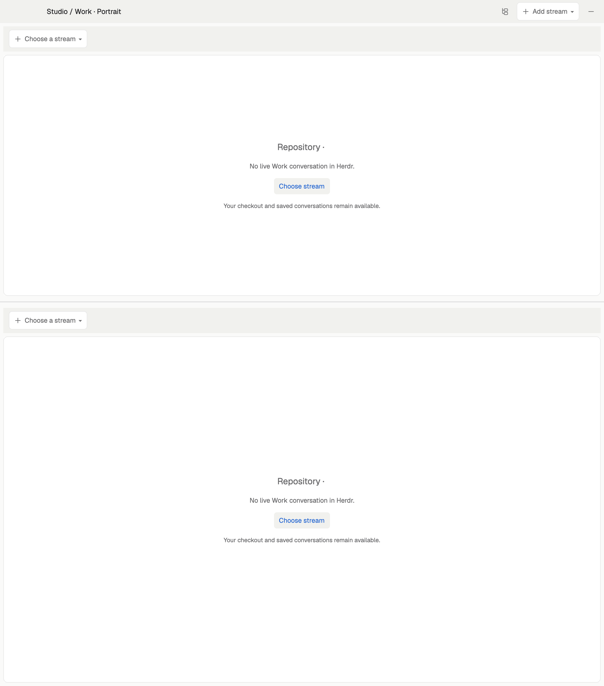
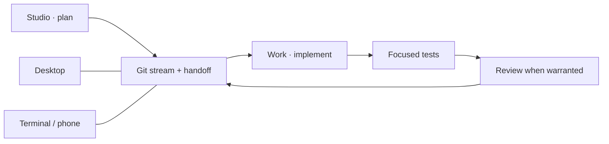

# Bollard for Herdr

**Two streams. One place to keep your agents from wandering off.**

Plan in **Studio**, build in **Work**, inspect the results without losing the
conversation. Desktop, terminal and phone use the same Herdr sessions.



*Three example conversations in the public Bollard repository. Start with two
stacked streams, then split or add windows to suit your screen.*



## Install

[Install the prerequisites](docs/setup.md#prerequisites), then:

On macOS, the desktop app is `brew install --cask herdr-app`; the terminal app
is `brew install herdr glow`. They are separate installs. Bollard supplies the
workflow and layouts, not those applications; see the setup guide for `hc` and
remote-host prerequisites.

```sh
git clone https://github.com/bruno-morel/bollard-herdr.git
cd bollard-herdr
./install.sh all --check-deps # show every missing prerequisite, including hc
./install.sh all              # look first
./install.sh all --apply      # install desktop + terminal
```

| Want only… | Use |
| --- | --- |
| Desktop | `./install.sh desktop --apply` |
| Terminal / remote host | `./install.sh tui --apply` |
| An update | `python3 sync.py all` |

In Herdr desktop, choose **studio-work-portrait**, then **Choose a stream**.
In a terminal, run `repo-tui`. No agent starts just because you installed a UI.
Installation checks required dependencies before changing files and prints
setup commands for anything missing. Sign in to agents and configure Docker
on the machine where you intend to run them; see the setup guide.

## What you can do

| Feature | Learn the controls |
| --- | --- |
| Open existing conversations, worktrees or branches; create streams | [Stream picker](docs/user-guide.md#your-first-stream) |
| Stack streams, split views and open separate windows | [Window layout](docs/user-guide.md#arrange-the-window) |
| Keep chat and pending questions together | [Conversation & Questions](docs/user-guide.md#conversation-and-questions) |
| Read/edit documents, browse files and inspect/merge Git changes | [Docs, Files & Git](docs/user-guide.md#docs-files-and-git) |
| Start a stream's Docker stack and inspect logs | [Docker](docs/user-guide.md#docker) |
| Run project tests, request independent review and check completion | [Tests & Review](docs/user-guide.md#tests-and-review) |
| Checkpoint a conversation or delegate scoped work | [Actions & helpers](docs/user-guide.md#actions-and-helpers) |
| Check agent activity, quotas, containers and Git status | [Information rail](docs/user-guide.md#information-rail) |
| Continue the same conversations from a terminal or phone | [TUI guide](docs/user-guide.md#terminal-and-phone) |

**[Full user guide: every control, organized by panel →](docs/user-guide.md)**

## Pick your next five minutes

| Task | Guide |
| --- | --- |
| Connect laptop, server or phone | [Setup](docs/setup.md) |
| Install/sign in to Codex, Claude or Cursor | [Agent guide](docs/agents.md) |
| Use the file browser or Docker panel in another layout | [Standalone mods](docs/standalone-mods.md) |
| Create custom roles and hand off between them | [Role profiles](docs/roles.md) |
| Plan → code → test → review | [Daily workflow](docs/workflow.md) |
| Change Bollard itself | [Development](docs/development.md) |
| Rebuild the desktop layout | [Gallery recipe](herdr/RECIPE.md) |

Project documents live in `docs/`. Big temporary stuff goes in ignored
`scratch/`. Credentials, histories and machine settings stay out of this repo.
Your tokens have enough places to go already.

Tested on macOS Apple Silicon and Intel. Linux is unverified; Windows is not
supported. This is an independent project, not an official Herdr product.

[Apache-2.0](LICENSE) · [Third-party notices](THIRD_PARTY_NOTICES.md)
