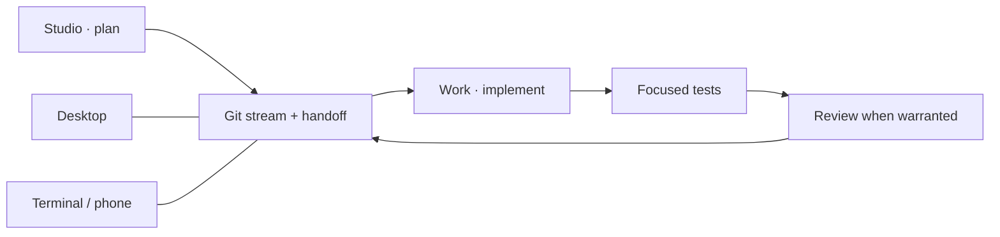

# Bollard for Herdr

**Two streams. One place to keep your agents from wandering off.**

Plan in **Studio**, build in **Work**, inspect the results without losing the
conversation. Desktop, terminal and phone use the same Herdr sessions.



## Install

[Install the prerequisites](docs/setup.md#prerequisites), then:

```sh
git clone https://github.com/bruno-morel/bollard-herdr.git
cd bollard-herdr
./install.sh all              # look first
./install.sh all --apply      # install desktop + terminal
```

| Want only… | Use |
| --- | --- |
| Desktop | `./install.sh desktop --apply` |
| Terminal / remote host | `./install.sh tui --apply` |
| An update | `python3 sync.py all` |

In Herdr desktop, choose **studio-work-portrait**, then **Choose a stream**.
In a terminal, run `repo-tui`. No agent starts just because you installed a UI.

## Pick your next five minutes

| Task | Guide |
| --- | --- |
| Connect laptop, server or phone | [Setup](docs/setup.md) |
| Install/sign in to Codex, Claude or Cursor | [Agent guide](docs/agents.md) |
| Plan → code → test → review | [Daily workflow](docs/workflow.md) |
| Change Bollard itself | [Development](docs/development.md) |
| Rebuild the desktop layout | [Gallery recipe](herdr/RECIPE.md) |

Project documents live in `docs/`. Big temporary stuff goes in ignored
`scratch/`. Credentials, histories and machine settings stay out of this repo.
Your tokens have enough places to go already.

Tested on macOS Apple Silicon and Intel. Linux is unverified; Windows is not
supported. This is an independent project, not an official Herdr product.

[Apache-2.0](LICENSE) · [Third-party notices](THIRD_PARTY_NOTICES.md)
