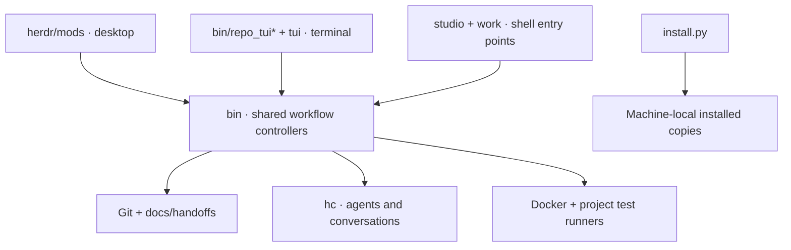
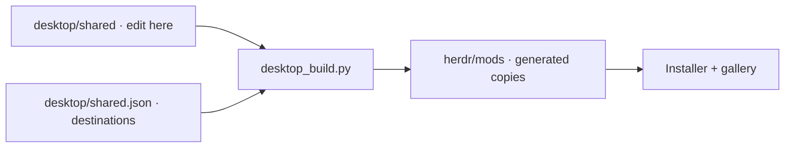

# Working on Bollard

Edit this checkout, not the deployed copies. Otherwise the installer quite
reasonably asks who moved its cheese.



| Boundary | Rule |
| --- | --- |
| Presentation | Show state; don't invent completion, allowance or conversation ownership. |
| Controllers | Own workflow decisions, evidence and retries. |
| Project | Durable artifacts in `docs/`; generated scratch stays ignored. |
| Machine | Credentials, histories, pins and counters stay outside Git. |

## Check a change

```sh
brew install glow node@22         # test tools, not runtime dependencies
export PATH="$(brew --prefix node@22)/bin:$PATH"
python3 desktop_build.py          # regenerate packaged helpers
python3 tests/run.py
python3 tests/check_sources.py
node --test tests/js/*.test.mjs
herdr-app check herdr/mods/repo-portrait  # if this mod changed
```

The test runner stages repository sources with an empty HOME, isolated Git
settings and temporary repositories. Agent calls are mocked. It must not borrow
installed workflow scripts, contact paid agents, or push product branches.
Native Herdr checks test loading/rendering; deferred UI actions still need
interaction checks. One green command doesn't cover the whole application.

## Shared desktop code

Herdr loads each mod in isolation. Edit `desktop/shared/`, then generate the
self-contained copies; don't fix the same bug in five folders.



The installer and CI reject stale copies. Node tests exercise file browsing,
stream selection and layout changes without starting an agent. Node is only
needed for development.

## Install and share

```sh
./install.sh all                   # inspect changes
./install.sh all --apply
./install.sh all --verify
git diff --check
git status --short
```

Commit intentional source changes and push. On the other machine, run
`python3 sync.py tui` (or its selected profile).

Herdr generates SDK declarations during checks; leave them untracked. Existing
layout files contain personal stream pins and are never overwritten by sync.
The optional `tenhumans` Zellij layouts retain project-specific service names;
the generic `work` layout doesn't require them.

## Cleanup in progress

See [the audit](maintenance.md) for open architectural work. Passing tests are
not permission to declare an audit finished.
