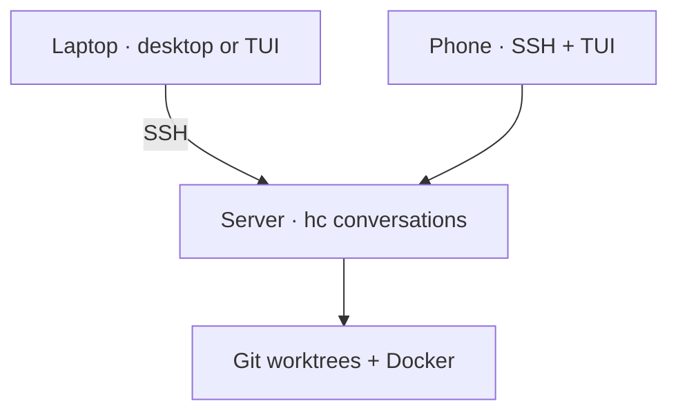

# Setup

## Prerequisites

| Machine | Install |
| --- | --- |
| Everywhere | Git, Python 3.9+, zsh, SSH, [herdr-core (`hc`)](https://herdr.dev/core/) |
| Desktop | [Herdr desktop (`herdr-app`)](https://herdr.dev/) |
| Terminal / phone host | Herdr terminal (`herdr`), Glow |
| Development host | Your chosen agent CLI, signed in; Docker + Compose for Work stacks |
| Zellij users | Zellij, lazygit |

No agent binaries or credentials are bundled. On macOS, Glow is one command:

```sh
brew install glow
export PATH="$HOME/.local/bin:$PATH"
```

Keep that PATH entry in your shell configuration, including the remote host.

## Laptop + server



Clone this repository on **each** machine. From its checkout:

```sh
# Laptop
./install.sh all --apply

# Server
./install.sh tui --apply
```

Add the server in Herdr. Select **studio-work-portrait** for the desktop layout.
Pick your own streams; the public layout ships without somebody else's terminal
IDs. `laptop` and `jumpbox` remain aliases for `all` and `tui`.

## Make plain `herdr` open Bollard

From the Bollard checkout:

```sh
printf '\nsource "%s/shell/herdr.zsh"\n' "$PWD" >> ~/.zshrc
source ~/.zshrc
herdr
```

Do this once per machine. Commands with arguments still go to native Herdr.
On a phone, SSH to the server and run `herdr` there.

## Updates

From your Bollard checkout, choose the installed profile:

```sh
python3 sync.py all       # laptop
python3 sync.py tui       # server
```

Sync refuses a dirty source checkout and uses fast-forward pulls. Installation
preserves existing desktop pins and detects edits made to deployed scripts.
Agents keep running; reopen the TUI to load changed Python code.

| Message | Fix |
| --- | --- |
| Edited outside maintained sources | Compare that installed file with the tracked source; reconcile it before updating. |
| Source checkout has changes | Commit or reconcile them. Sync will not stash them behind your back. |
| Command not found | Check PATH and prerequisites on the machine actually running the command. |
| Empty layout | Choose a stream; this is not a lost conversation. |

`./install.sh all` previews changes. `./install.sh all --verify` checks installed
code. Personalized layouts are seeded once, not compared byte-for-byte afterward.
