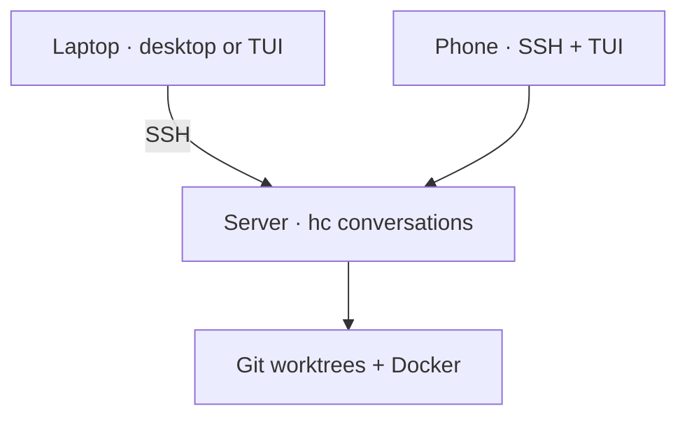

# Setup

## Prerequisites

From the Bollard checkout, start with:

```sh
./install.sh all --check-deps     # desktop + terminal on this laptop
./install.sh tui --check-deps     # terminal-only / SSH host
```

The checker lists **all** missing prerequisites together with installation
commands, including `hc`. Run the suggested commands, then repeat the check.
`--apply` also checks first and stops before writing files when a required
dependency is missing. A normal preview includes the same checklist.
These checks guide installation; they never download software, sign you in,
start agents or start Docker. `--verify` checks installed Bollard files and
also reports prerequisites; use `--check-deps` for a dependency-only pass/fail.

Git, zsh, SSH and `hc` are required everywhere. Desktop checks `herdr-app`;
terminal checks `herdr` and Glow. Docker/Compose and agent CLIs are reported
as optional locally because they may live only on your remote development host.
The checker tests executable discovery and Compose availability, not provider
authentication or whether Docker is running. Python 3.9+ is checked before the
installer can run; `install.sh` explains how to install it when missing.

| Machine | Install |
| --- | --- |
| Everywhere | Git, Python 3.9+, zsh, SSH, [herdr-core (`hc`)](https://herdr.dev/core/) |
| Desktop | [Herdr desktop (`herdr-app`)](https://herdr.dev/) |
| Terminal / phone host | Herdr terminal (`herdr`), Glow |
| Development host | Your chosen agent CLI, signed in; Docker + Compose for Work stacks |
| Zellij users | Zellij, lazygit |

See [Agents: install, sign in, choose](agents.md) for Codex, Claude and Cursor commands and feature support.

### 1. Install Herdr itself

Bollard installs scripts and layouts, **not Herdr itself**. Three names refer
to different programs: `herdr-app` is the desktop app, `herdr` is the terminal
app, and `hc` is the runtime that keeps agent conversations alive.

For the **desktop experience on a Mac with Apple Silicon**:

```sh
brew install --cask herdr-app
open -a Herdr
```

Open the app once before installing Bollard's desktop layout. For Linux and
other installation options, use the [official desktop download](https://herdr.dev/download/).
The prebuilt macOS desktop app requires Apple Silicon; an Intel remote server
does not need the desktop app.

For the **terminal experience**, install on every machine where you will run
`repo-tui` or the Bollard `herdr` shortcut, including the SSH host for your phone:

```sh
brew install herdr glow
```

The desktop cask does not replace this terminal dependency. Without Homebrew,
follow the [official TUI installation guide](https://herdr.dev/tui/docs/install/).

For the **agent runtime**, the desktop app sets up herdr-core. On a server, or
if `hc` is missing, use the [official core installer](https://herdr.dev/core/):

```sh
curl -fsSL https://releases.herdr.dev/core/install.sh | sh
export PATH="$HOME/.local/bin:$PATH"
hc --version
```

Keep that PATH entry in your shell configuration, including the remote host.
For a terminal installation, verify the actual executable before enabling the
shell shortcut:

```sh
command herdr --version
glow --version
```

No agent binaries or credentials are bundled. Install and sign in to your chosen
agent using the [agent guide](agents.md), then install Bollard below.

## Laptop + server



Clone this repository on **each** machine. From its checkout:

```sh
# Laptop
./install.sh all --check-deps
./install.sh all --apply

# Server
./install.sh tui --check-deps
./install.sh tui --apply
```

After `hc --version` works on both machines, connect from the **laptop**:

```sh
hc machine add your-user@your-server
hc machine ls
```

You can also add the server in Herdr desktop. Select **studio-work-portrait** for the desktop layout.
Pick your own streams; the public layout ships without somebody else's terminal
IDs. `laptop` and `jumpbox` remain aliases for `all` and `tui`.

## Make plain `herdr` open Bollard

From the Bollard checkout:

```sh
printf '\nsource "%s/shell/herdr.zsh"\n' "$PWD" >> ~/.zshrc
source ~/.zshrc
herdr
```

Do this once per machine. Commands with arguments still go to native Herdr.
On a phone, SSH to the server and run `herdr` there.

## Updates

From your Bollard checkout, choose the installed profile:

```sh
python3 sync.py all       # laptop
python3 sync.py tui       # server
```

Sync refuses a dirty source checkout and uses fast-forward pulls. Installation
preserves existing desktop pins and detects edits made to deployed scripts.
Agents keep running; reopen the TUI to load changed Python code.

| Message | Fix |
| --- | --- |
| Edited outside maintained sources | Compare that installed file with the tracked source; reconcile it before updating. |
| Source checkout has changes | Commit or reconcile them. Sync will not stash them behind your back. |
| Command not found | Check PATH and prerequisites on the machine actually running the command. |
| Herdr terminal executable was not found / old `NoneType` launch traceback | Install the terminal app with `brew install herdr` on that machine, then retry `repo-tui`. Installing only the desktop app or `hc` is insufficient. Update Bollard to get the clearer dependency error. |
| Empty layout | Choose a stream; this is not a lost conversation. |

`./install.sh all` previews changes. `./install.sh all --verify` checks installed
code. Personalized layouts are seeded once, not compared byte-for-byte afterward.
