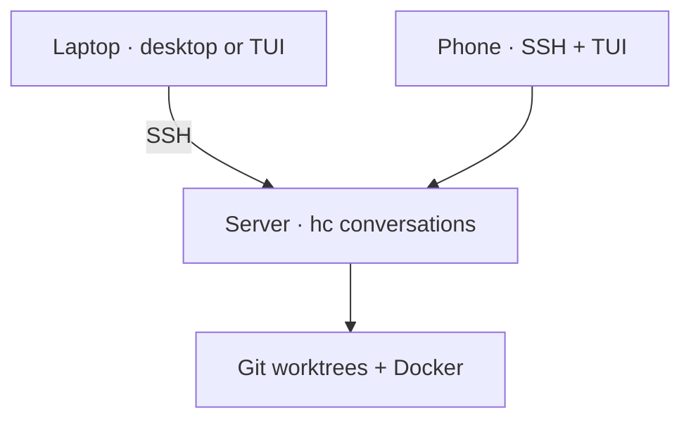

# Setup

## Get the setup repository

Start in a normal terminal on your laptop. Install Git and Python 3.9+ first
if needed (`brew install git python` on macOS with Homebrew), then:

```sh
mkdir -p ~/src
git clone https://github.com/bruno-morel/bollard-herdr.git ~/src/bollard-herdr
cd ~/src/bollard-herdr
```

This is the **tooling repository**, not the app/product repository you will work
on. Keep it at this path after installing the optional shell shortcut below.
If already cloned, use that checkout rather than cloning over it.

## Prerequisites

From the Bollard checkout, start with:

```sh
./install.sh all --check-deps     # desktop + terminal on this laptop
./install.sh tui --check-deps     # terminal-only / SSH host
```

The checker lists **all** missing prerequisites together with installation
commands, including `hc`. Run the suggested commands, then repeat the check.
`--apply` also checks first and stops before writing files when a required
dependency is missing. A normal preview includes the same checklist.
These checks guide installation; they never download software, sign you in,
start agents or start Docker. `--verify` checks installed Bollard files and
also reports prerequisites; use `--check-deps` for a dependency-only pass/fail.

Git, zsh, SSH and `hc` are required everywhere. Desktop checks `herdr-app`;
terminal checks `herdr` and Glow. Docker/Compose and agent CLIs are reported
as optional locally because they may live only on your remote development host.
The checker tests executable discovery and Compose availability, not provider
authentication or whether Docker is running. Python 3.9+ is checked before the
installer can run; `install.sh` explains how to install it when missing.

| Machine | Install |
| --- | --- |
| Everywhere | Git, Python 3.9+, zsh, SSH, [herdr-core (`hc`)](https://herdr.dev/core/) |
| Desktop | [Herdr desktop (`herdr-app`)](https://herdr.dev/) |
| Terminal / phone host | Herdr terminal (`herdr`), Glow |
| Development host | Your chosen agent CLI, signed in; Docker + Compose for Work stacks |
| Zellij users | Zellij, lazygit |

See [Agents: install, sign in, choose](agents.md) for Codex, Claude and Cursor commands and feature support.

### 1. Install Herdr itself

Bollard installs scripts and layouts, **not Herdr itself**. Three names refer
to different programs: `herdr-app` is the desktop app, `herdr` is the terminal
app, and `hc` is the runtime that keeps agent conversations alive.

For the **desktop experience on a Mac with Apple Silicon**:

```sh
brew install --cask herdr-app
open -a Herdr
```

Open the app once before installing Bollard's desktop layout. For Linux and
other installation options, use the [official desktop download](https://herdr.dev/download/).
The prebuilt macOS desktop app requires Apple Silicon; an Intel remote server
does not need the desktop app.

For the **terminal experience**, install on every machine where you will run
`repo-tui` or the Bollard `herdr` shortcut, including the SSH host for your phone:

```sh
brew install herdr glow
```

The desktop cask does not replace this terminal dependency. Without Homebrew,
follow the [official TUI installation guide](https://herdr.dev/tui/docs/install/).

For the **agent runtime**, the desktop app sets up herdr-core. On a server, or
if `hc` is missing, use the [official core installer](https://herdr.dev/core/):

```sh
curl -fsSL https://releases.herdr.dev/core/install.sh | sh
export PATH="$HOME/.local/bin:$PATH"
hc --version
```

Keep that PATH entry in your shell configuration, including the remote host.
For a terminal installation, verify the actual executable before enabling the
shell shortcut:

```sh
command herdr --version
glow --version
```

No agent binaries or credentials are bundled. Install and sign in to your chosen
agent using the [agent guide](agents.md), then install Bollard below.

## Laptop + server



Clone this repository on **each** machine. From its checkout:

For a remote host, first verify SSH from the laptop (`ssh your-user@your-server`).
Accept its host key only after checking it, then use a normal remote shell to
repeat the clone, prerequisite installation and checks above. Agent login,
project files and Docker belong on that host, not on the viewing laptop.

```sh
# Laptop
./install.sh all --check-deps
./install.sh all --apply

# Server
./install.sh tui --check-deps
./install.sh tui --apply
```

After `hc --version` works on both machines, connect from the **laptop**:

```sh
hc machine add your-user@your-server
hc machine ls
```

Use the same SSH destination that worked in your shell. If this fails, resolve
SSH authentication or the remote `hc` installation/PATH first. The command adds
a machine connection, not a Git repository or a conversation. Adding a host
does not copy your laptop's project files there.

You can also add the server in Herdr desktop. On the first desktop installation,
Bollard automatically selects **studio-work-portrait** in the open primary Herdr
window. Herdr remembers that selection. Later updates preserve your chosen
layout, stream pins and additional windows. Keep Herdr open during installation.

If Herdr was closed, the installer prints the exact selection command. To select
Bollard explicitly on an existing installation:

```sh
./install.sh desktop --apply --select-layout
# Or, after opening Herdr:
herdr-app do layout.switch '{"name":"studio-work-portrait"}'
```

Selecting a layout does not create or restart agents. The flag targets the
primary desktop window; it does not replace custom per-stream windows.
Pick your own streams; the public layout ships without somebody else's terminal
IDs. `laptop` and `jumpbox` remain aliases for `all` and `tui`.

## Open your first project and stream

1. On the **agent machine**, clone your actual project repository (or use an
   existing checkout). It must have at least one commit. For a new local project,
   initialize Git and make an initial commit before opening a stream.
2. In that checkout, check `git status --short --branch`, `git config user.name`
   and `git config user.email`. Configure your own commit identity if missing.
   Confirm the selected agent is installed and signed in there using the
   [agent guide](agents.md). No paid conversation is needed just to install Bollard.
3. In Herdr, click **Choose a stream → New conversation**, select the machine,
   and choose the repository. On a fresh install there may be no suggestions:
   use **Choose another repository** (or the repository path field) and enter
   its absolute path **on that machine**. Do not enter a GitHub URL or the
   laptop's path for a remote project.
4. Start with **Studio** for a planning conversation without Docker. Choose
   **New stream**, the project's default branch, a name such as `first-plan`,
   and your signed-in agent. Submit once and watch the opening progress.
   The repository gets a separate worktree, `docs/` guidance, a handoff folder
   and ignored `scratch/`; you should see the agent confirm its role and branch.
5. To return, use **Existing conversation**. It attaches to that conversation;
   it should not create another worktree or another agent. The second layout
   slot may stay empty until you choose another stream.

The TUI uses the same **Change stream / New conversation** picker. Start it
with `repo-tui` on the laptop or over SSH on the server. The shell shortcut
below is optional. A new checkout can start from a local committed `main`
through the picker; a fetched remote branch needs working Git credentials.

For **Work**, first prepare the implementation handoff when coming from Studio,
and ensure the development host has a working Docker engine/Compose and the
project's required configuration and environment files. Follow the
[daily workflow](workflow.md) before starting the coding role. Work is not a
Docker-free installation smoke test. A remote connection, an agent login, and
Git remote authentication are separate checks; one succeeding does not prove
the other two are ready.

## Make plain `herdr` open Bollard

From the Bollard checkout:

```sh
printf '\nsource "%s/shell/herdr.zsh"\n' "$PWD" >> ~/.zshrc
source ~/.zshrc
herdr
```

Do this once per machine. Commands with arguments still go to native Herdr.
On a phone, SSH to the server and run `herdr` there.

## Updates

From your Bollard checkout, choose the installed profile:

```sh
python3 sync.py all       # laptop
python3 sync.py tui       # server
```

Sync refuses a dirty source checkout and uses fast-forward pulls. Installation
preserves existing desktop pins and detects edits made to deployed scripts.
Agents keep running; reopen the TUI to load changed Python code.

| Message | Fix |
| --- | --- |
| Edited outside maintained sources | Compare that installed file with the tracked source; reconcile it before updating. |
| Source checkout has changes | Commit or reconcile them. Sync will not stash them behind your back. |
| Command not found | Check PATH and prerequisites on the machine actually running the command. |
| Herdr terminal executable was not found / old `NoneType` launch traceback | Install the terminal app with `brew install herdr` on that machine, then retry `repo-tui`. Installing only the desktop app or `hc` is insufficient. Update Bollard to get the clearer dependency error. |
| Empty layout | Choose a stream; this is not a lost conversation. |

`./install.sh all` previews changes. `./install.sh all --verify` checks installed
code. Personalized layouts are seeded once, not compared byte-for-byte afterward.

### Input colors in background agent conversations

Desktop stream creation, reopening, and workflow retries pass the originating
window’s foreground/background colors to Herdr before the program starts.
This prevents an agent from detecting Herdr’s headless default palette before
its light-theme window attaches. The palette travels with the setup worker and
agent launcher; existing conversations are never restarted to change colors.
Terminal-only launches retain `hc`’s normal terminal detection.

An already-running agent may retain the colors it detected at startup. Finish
its current task and resume that saved conversation from the desktop picker to
apply the startup fix. Do not create a new conversation just to change colors.
Switching a viewer between light and dark after launch still depends on the
agent’s support for live color changes.
