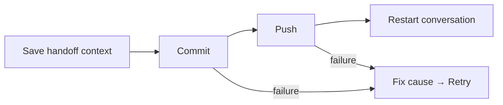

# A day with Bollard

## Start a stream

In the picker: choose an active conversation, an existing worktree, a remote
branch, or a new stream. Pick **Studio** to plan; **Work** to implement.
Existing conversations keep their role.

From a project checkout, the CLI equivalent starts here:

```sh
studio herdr my-feature
```

## Hand it over

Finish the brief and acceptance criteria in Studio. Then, from a shell in that
project:

```sh
cd "$(work path my-feature)"
studio handoff
work herdr my-feature
```

Desktop actions **Prepare implementation** and **Implement → Review** provide
the guided route. Both roles share the checkout and handoff. Going back to
planning does not erase implementation progress.

## Look before you merge

| Tool | What it shows |
| --- | --- |
| Docs | Markdown and text, rendered for reading |
| Files | Repository files, browsable by directory |
| Git | Changed files and diffs |
| Docker | Logs, copy logs, explicit stack start |
| Tests | Project checks and their results |
| Review | Independent review and completion evidence |

Tests use the project's runners. Small changes should get focused checks;
riskier changes need broader evidence. Claude reviews are bounded and explicit.
Opening Review does not spend the allowance. Green is evidence, not a force field.

Ask the agent to show a file, or pick one yourself. The conversation stays put.
**Ask a helper about this** starts separate, read-only Codex/Cursor help with the
pane's context. Claude is reserved for review, not every passing thought.

## Fresh conversation, same work

Choose **New conversation** in Actions. Watch the checkpoint:



This commits and pushes your stream. A failed step is visible; retry rechecks
identity and resumes the checkpoint. It does not invent a clean slate.

## Leaving

Detach to leave an agent running. Closing a session is different from deleting
its worktree. Read `work --help` before removal: force removal can discard changes
and Docker volumes. The button is not a time machine.
