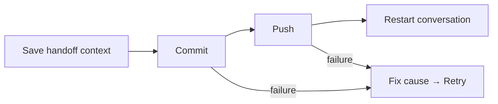

# A day with Bollard

## Start a stream

In the picker: choose an active conversation, an existing worktree, a remote
branch, or a new stream. Pick **Studio** to plan; **Work** to implement.
Existing conversations keep their role.

From a project checkout, the CLI equivalent starts here:

```sh
studio herdr my-feature
```

## Hand it over

Finish the brief and acceptance criteria in Studio. Then, from a shell in that
project:

```sh
cd "$(work path my-feature)"
studio handoff
work herdr my-feature
```

Desktop actions **Prepare implementation** and **Implement → Review** provide
the guided route. Both roles share the checkout and handoff. Going back to
planning does not erase implementation progress.

## Look before you merge

| Tool | What it shows |
| --- | --- |
| Docs | Markdown and text, rendered for reading |
| Files | Repository files, browsable by directory |
| Git | Changed files and diffs |
| Docker | Logs, copy logs, explicit stack start |
| Tests | Project checks and their results |
| Review | Independent review and completion evidence |

Tests use the project's runners. Small changes should get focused checks;
riskier changes need broader evidence. Claude reviews are bounded and explicit.
Opening Review does not spend the allowance. Green is evidence, not a force field.

Ask the agent to show a file, or pick one yourself. The conversation stays put.
**Ask a helper about this** starts separate, read-only Codex/Cursor help with the
pane's context. Claude is reserved for review, not every passing thought.

## First test run

Use **First tests run** in the Tests panel. A read-only Codex/Cursor child inspects
the project's runners, writes the check list, then starts the first run. The lead
stays available. No Claude call.

For the CLI, get the lead's terminal ID with `hc ls`, then substitute it below:

```sh
work tests first my-feature --target tID
work tests status my-feature
```

Later, **Rerun tests** uses that saved list. Checks live in
`docs/handoffs/my-feature/tests-input.json` (or the review input fallback).
No configured checks? Define them first; an empty list isn't a passing test suite.

## Check completion without rerunning tests

```sh
work complete my-feature --init    # create the risk/coverage form once
# Fill docs/handoffs/my-feature/validation-plan.json before running checks.
work tests run my-feature         # run the configured project checks
work complete my-feature --status # inspect evidence; no tests or Claude calls
work complete my-feature          # record completion, or explain what's missing
```

| Result | Meaning |
| --- | --- |
| Completed | Current source, selected checks and evidence agree. |
| Completed with limitations | Explicit gaps or deferred review remain. Read them. |
| Blocked | Missing, stale, failed or incomplete evidence. No receipt written. |

Low risk can finish with focused checks. Medium/high risk needs independent
review or a written deferral; high risk also needs recovery/rollback notes.
The guided review workflow still requires independent verification. A title
change doesn't need a ceremonial two-hour test marathon.

Changed source or test commands invalidate old evidence. Missing results,
duplicate test results and altered logs block completion. Review reruns keep
separate logs; every attempt must pass. Status is read-only; it never
spends Claude allowance or grants permission to merge.

## Fresh conversation, same work

Choose **New conversation** in Actions. Watch the checkpoint:



This commits and pushes your stream. A failed step is visible; retry rechecks
identity and resumes the checkpoint. It does not invent a clean slate.

## Wrong repository? Transfer the documents

From the source repository, with the destination on a clean main/master checkout:

```sh
studio transfer my-feature /path/to/destination           # preview
# Pause the source agent before applying the snapshot.
studio transfer my-feature /path/to/destination --apply
```

This creates a destination stream and copies selected documents. It preserves
the source and existing briefs; it does not migrate conversation history or push
commits. Conflicts stop the transfer. If preparation fails after creating the
worktree, the printed path is retained for inspection—not deleted behind you.

## Leaving

Detach to leave an agent running. Closing a session is different from deleting
its worktree. Read `work --help` before removal: force removal can discard changes
and Docker volumes. The button is not a time machine.
