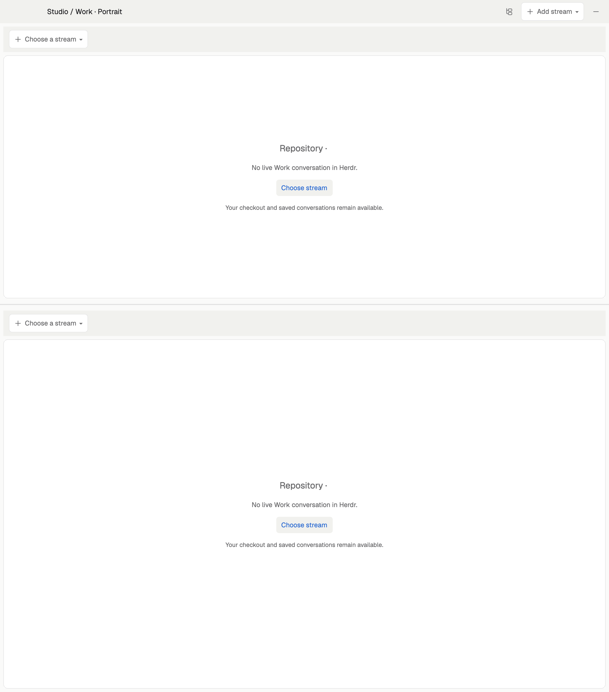

# Bollard for Herdr

A portrait workspace with two independently selected Git streams: planning above,
implementation below, or any two conversations you choose. Each stream keeps a
large agent conversation, tools above it and optional compact information beside
it. Studio and Work share handoffs and use the same repository-aware controllers
as the companion terminal dashboard.



The preview shows a clean first launch. It deliberately contains no saved host,
project, terminal IDs, conversations or account usage. Choose a stream in either
half to reveal its controls.

## What you see

- A 42px global bar with a sidebar toggle and Add stream menu. Start with two
  stacked regions; support additional horizontal or vertical splits and windows.
- A hidden-by-default left sidebar, 168px initially, showing spaces grouped by
  repository/folder and agent notifications when expanded.
- Each stream has a compact toolbar: repository/stream picker on the left,
  conversation state and tool choices on the right. Overflow should wrap safely
  rather than hide controls on a narrow window.
- A large conversation surface with native terminal interaction. Optional tools
  appear above it: Docker, Docs/Files/Git, Tests/Review and Questions.
- Docs is Markdown/text; Files browses all file types; Git presents changed files
  with their diffs. Offer folder, type and list modes and prefer modified files.
- The information panel sits beside the conversation, initially hidden. It is
  roughly one-quarter width, constrained to 210–430px. Tabs show agent/model
  information, usage meters and compact Docker memory/status cards.
- Use Herdr theme colors: white/light conversation surfaces in a light theme,
  muted tool surfaces and a contrasting information area. Status colors are
  green/yellow/red, with muted idle states. Use supplied line icons and native
  terminal typography; do not introduce decorative pets or CPU/network meters.

## How it behaves

Choose stream offers active conversations, existing worktrees, remote branches
and a new stream from a base branch. Existing conversation identity is retained.
Studio/Work roles apply when starting agents, not as a silent role switch for an
existing conversation. Selection, file viewing and UI expansion must not launch
another agent accidentally.

Working agents retain their conversation; questions need attention, idle/finished
work gets a subdued attention treatment, and actual failures are red. Show only
available model, reasoning and quota data—missing data is not zero usage.

Conversation hides the tool area. Docs/Files/Git and Tests/Review are grouped
pickers whose labels reflect the selected view. Right-aligned action buttons
belong above pane content. Docker streams scrollable, copyable logs; no stack
shows a friendly empty state and an explicit Start Docker action.

A requested file opens in the tools region without replacing the conversation.
Helpers receive pane context and default to read-only Codex/Cursor work. Claude
review remains an explicit, bounded independent review. Tests use the project's
runners and report failures, not a fabricated pass. Completion checks inspect
existing risk/test evidence rather than rerunning everything.

Checkpoint/new-conversation saves handoff context, commits and pushes the stream
before restarting. Show stages and failures; retry resumes a failed step with
identity checks. Never silently restart a running conversation or reset allowance
state. Hover tooltips explain compact icon controls.

## Built from

The `studio-work-portrait` layout is a column: manager bar plus a row containing
sidebar and the stream tree. Each lane is a column with its toolbar, hidden tools
region and a row containing the conversation and hidden information block.

`repo-portrait` renders manager, toolbar, empty-conversation and information
roles, coordinating scoped lane state. `repo-portrait-reader`,
`repo-portrait-changes` and `repo-portrait-review` render tools. `repo-stream-picker`
handles selection; `repo-helper`, `repo-sync`, `repo-folders`, `repo-workflow`,
`repo-spaces`, `repo-tabs` and `repo-menu` provide the associated controls.
`repo-reader` and `repo-review` support the alternative desktop layout.

Shared helpers are maintained in `desktop/shared/` at the repository root.
Run `python3 desktop_build.py` after editing them; the generated copies keep
each mod independently loadable.

Use native `gpui-kit`/`gpui-base` views and Herdr APIs, not DOM components. Commands
and async operations go through the supplied adapters. Shipped `agents` and
`workspace-chrome` mods remain external Herdr dependencies. Icons are in the mod
folders. The window helper is `helpers/window.py`.

**This is not a standalone visual-only layout.** Install the repository's shared
`bin/` controllers on the development hosts and desktop helpers on the UI host:

```sh
./install.sh desktop --apply
# On a remote development host, from its clone:
./install.sh tui --apply
```

The package runs repository commands via `hc` and SSH, uses installed agent CLIs,
Git and optionally Docker, Glow and Zellij. Read the root README and controller
sources before installing. Credentials and runtime state live outside Git.

## Watch out

Keep each pane bound to its own machine/repository/stream. Two visible streams
must never share a mutable global selection. Avoid duplicate launchers claiming
the same conversation. Do not create worktrees just to display a picker.

Herdr's native dropdowns and async rendering require native checks and actual
interaction checks. A successful initial render does not test every deferred
state. Preserve personal layout pins during upgrades and do not publish live
terminal IDs. Existing mods must be reconciled, not overwritten blindly.

Desktop UI and TUI are separate presentations of the same backend. This gallery
folder describes the desktop; `tui/` and `bin/repo_tui*` implement terminal/phone
presentation. Tested hosts are macOS; other platforms are not yet verified.

## Done when

- A clean layout starts with two unpinned streams and no errors.
- Choosing an existing stream preserves its conversation identity.
- Tools open above their own conversation; Docs file requests do not replace it.
- Empty Docker state, failed tests and missing review authentication are explicit.
- Merely displaying Review consumes no Claude allowance.
- Checkpoint progress and retry preserve the stream and report failures.
- `python3 tests/run.py`, `python3 tests/check_sources.py` and native
  `herdr-app check` pass; no real agent is launched by automated tests.
